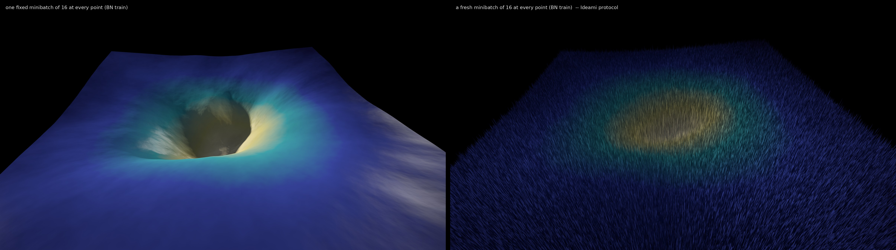
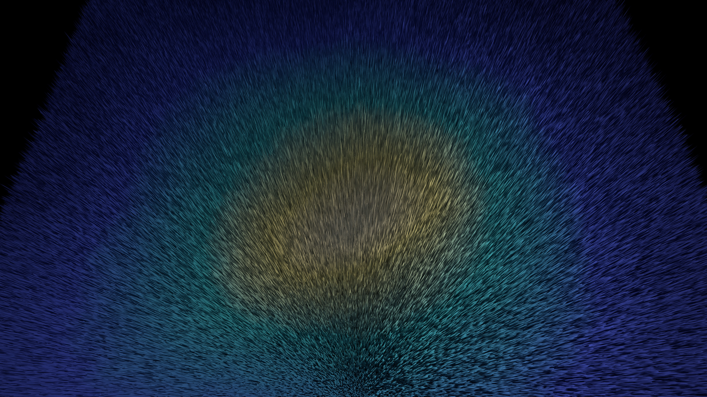
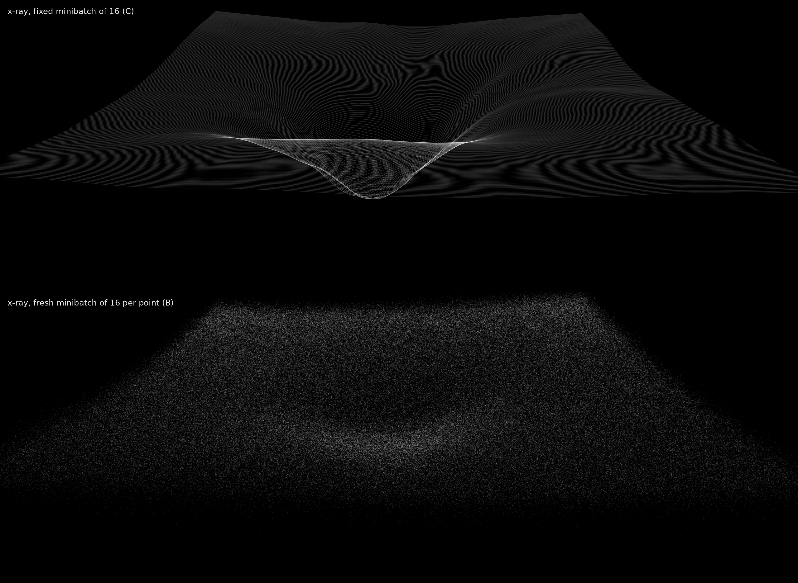
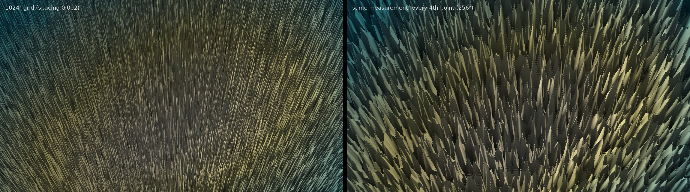
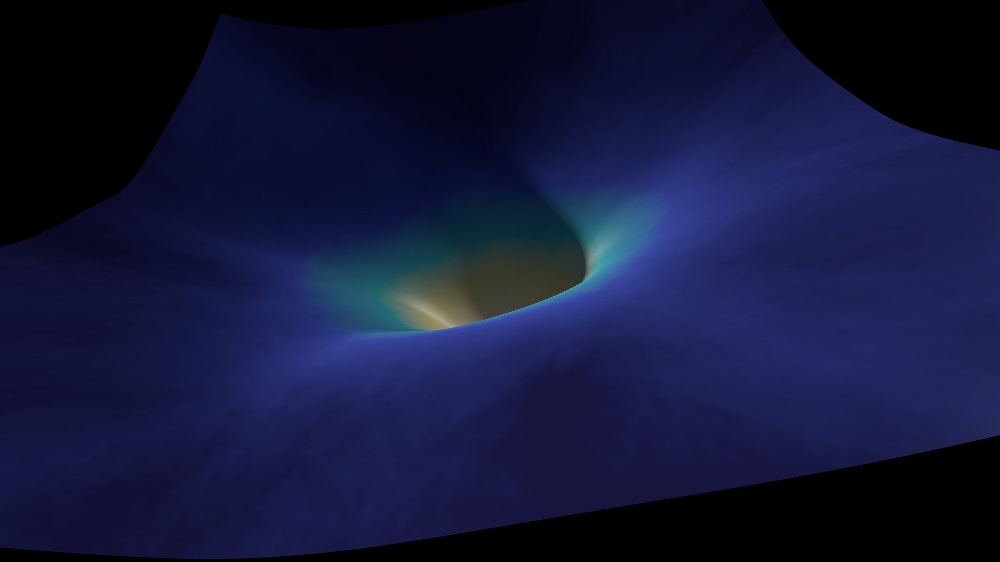
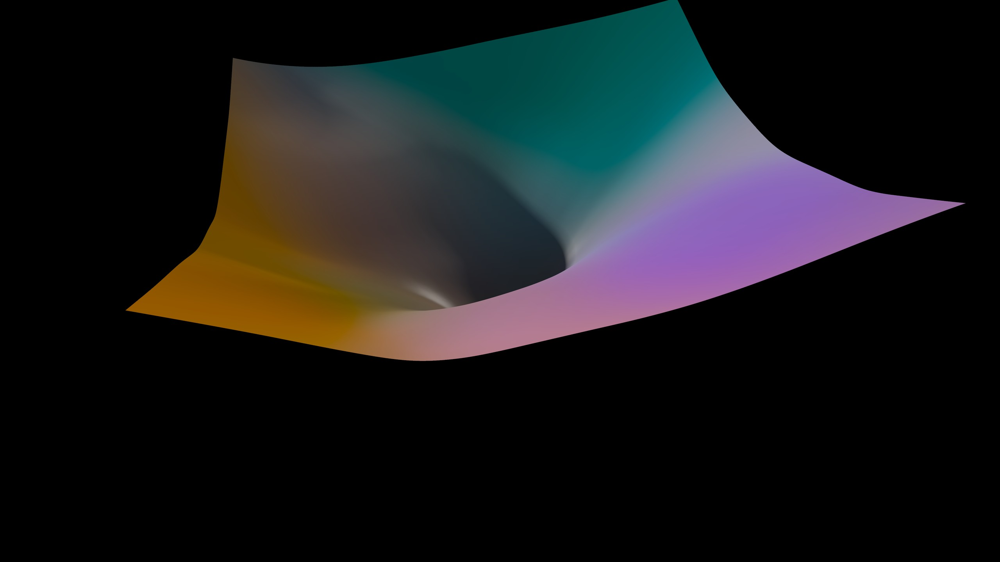
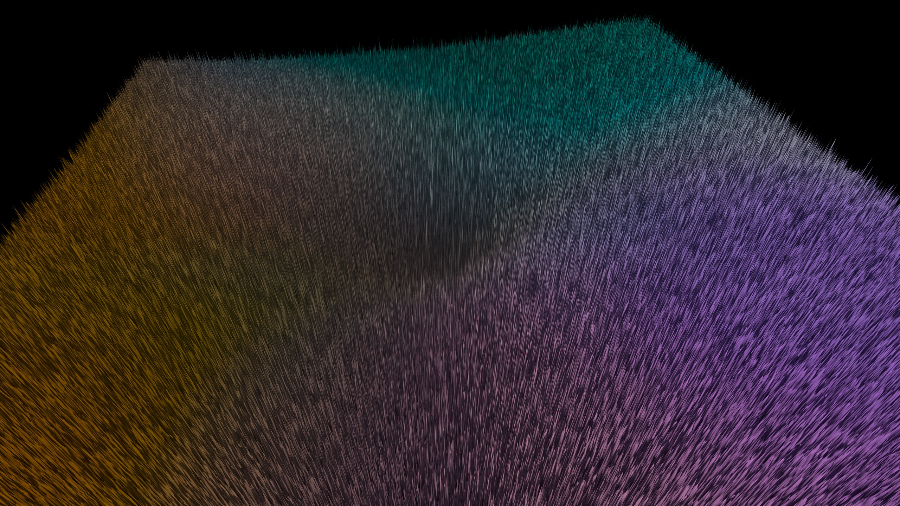
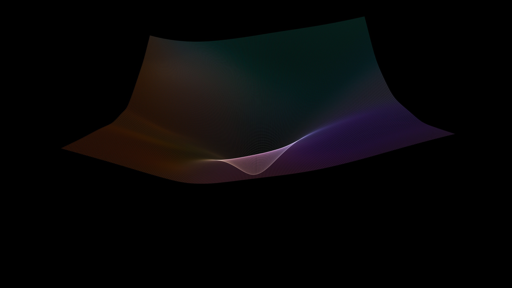

# Dense Landscape: is the fur landscape, or sampling noise?

*A test of whether this repo can make loss-landscape images as dense as Javier Ideami's
[losslandscape.com](https://losslandscape.com/gallery/) gallery, but honestly. The answer to the
question in the title turned out to be the most interesting result.*

**Headline.** On a 1024² filter-normalised plane (Li et al. 2018) around a trained BN convnet, the
Ideami-style measurement (a fresh minibatch of 16 at every grid point, BN in train mode) produces
exactly the famous fur. **99.86% of that fine texture is minibatch sampling noise.** Two
independent runs over the same plane agree on the bowl (raw r = 0.80), but their high-passed
textures correlate at **r = 0.0014**. The noise is white: lag-1 autocorrelation 0.0002, 1/e
correlation length **0.64 grid cells**. Freeze the minibatch and the fur disappears: RMS second
difference drops **4,300×**, even with bs = 16 and BN still in train mode. So the grain of the fur
is set by the **grid spacing** the artist chose, not by the network (see the grain study).



*Same plane, same camera, light, colour and height scale. Left: one fixed minibatch of 16 at every
point. Right: a fresh minibatch of 16 at every point. The only change is resampling the data.*



*The Ideami protocol at 1024², 5120 × 2880 (full resolution in the gallery). Colour = accuracy on a
fixed 1024-image set (measured, see below), height = the per-point bs-16 loss. The gold basin is
real. Every needle is one draw of 16 images.*



*"X-ray" (additive hairlines along 256 constant-β rows, no depth test). The fixed minibatch gives
Ideami-like silk. Fresh minibatches dissolve the same lines into fog: the lines are there, the
noise just erases them.*



*The same measurement drawn at every point (1024²) and at every 4th point (256²), with an identical
crop. The needles get 4× coarser. A real landscape feature would not change size with the sampling
grid; this texture does.*

 

*The "true" smooth surface A: a fixed 1024 training images, BN in eval mode. Left: colour =
accuracy. Right: colour = function identity (PCA3 of the net's predictions on 256 probes →
OKLab).*

 

*Left: the Ideami measurement coloured by function identity. Right: x-ray of A in function-identity
colour.*

Contact sheet: `gallery/contact_sheet.png`. Numbers figure: `gallery/study_noise.png`.

## What was measured

Net: `ConvNet4`, four conv3×3-BN-ReLU layers (16, 32, 64, 64 channels, with max-pooling between),
GAP and a linear layer, 69k parameters. It was trained on CIFAR-10 for 40 epochs with SGD +
Nesterov, one-cycle lr 0.05, wd 5e-4, bs 128 and crop/flip augmentation. Result: **86.7% train /
83.4% test**, train loss 0.386 (`train.py`). Imagenette is not cached locally, so this is CIFAR-10.

Plane: Li et al. directions (seeds 1 and 2). BN and bias entries are zeroed and each filter is
rescaled to the norm of the trained filter. The grid is α, β ∈ [−1, 1], spacing 0.00196 at 1024².
Every measurement below is on this **same plane** (`measure.py`, `dl_common.py`).

| id | protocol | grid | why |
|---|---|---|---|
| **A** | fixed 1024 train images, BN **eval** | 256² measured (+ 8 exact 1024-res rows) | the smooth "true" surface |
| **B** | **fresh random 16 train images per point**, BN **train** | 1024², seeds 1 and 2 | Ideami protocol ("bs=16, bn, train mod") |
| **C** | one fixed minibatch of 16, BN train | 1024² | B with the resampling removed |
| **E[B]** | the fixed 1024 images as 64 fixed minibatches of 16, BN train, averaged | 128² | the mean surface of B |
| **D** | fresh 16 per point, BN **eval** | 256² | sampling noise without BN train mode |
| colour | accuracy (A, and E[B] for B/C); function identity: argmax agreement with the centre on 256 test probes, and PCA3 of the 256×10 softmax outputs (basis from a 64² coarse grid; top-3 PCs explain 18.9 / 13.3 / 10.3%) | with A | colour comes from data, not from height |

Everything ran in fp32 with TF32 off. The batched evaluator runs P perturbed nets as one grouped
convolution; at P = 1 it matches the `nn.Module` to 6·10⁻⁷. A linearity-trick variant
(conv(h, w₀) + α conv(h, dx) + β conv(h, dy)) measured **10× slower** on the GB10: it triples
memory traffic, and this net is memory-bound (raw forward ≈ 230k img/s, 1.5 TFLOPS). That speed
is why A is 256² rather than 1024². At 2048 images a 1024² A would have taken ≈ 8 h.

## The noise finding (numbers from `cache/noise_stats.json`, `analyze.py`)

All values are in log10 loss, the rendered height.

| quantity | value |
|---|---|
| noise sd of one bs-16 point, from var(B − B′)/2 | **0.096 decades (≈ ±25% in loss)** |
| noise share of B's total variance over the plane | 19.9% (the bowl is the other 80%) |
| corr(B, B′), raw | 0.80 |
| corr(high-pass B, high-pass B′), Gaussian σ = 1, 2, 4, 8 cells | **0.0014, 0.0014, 0.0013, 0.0013** → 99.87% of texture is noise at every scale ≤ 8 cells |
| ACF of B − B′ at lag 1 (α / β) | 0.0002 / 0.0003 (white) |
| ACF of B − E[B] at lags 1–12 | ≈ 0.01, flat (a small smooth Jensen offset, not texture) |
| correlation length of the residual | **0.64 grid cells** = 0.0013 in α |
| RMS second difference: B / A / C | 0.236 / 4.0·10⁻⁵ / 5.5·10⁻⁵ → **B is 5,900× rougher than A and 4,300× rougher than C** |
| noise sd by level of E[B] | 0.149 in the basin → 0.077 on the plateau (the fur is longest where the loss is lowest) |
| D (fresh 16, BN eval) noise sd | 0.099 ≈ B's 0.096 → **BN train mode adds essentially no noise; resampling does it** |
| E[B] − A | mean −0.65 decades, sd 0.30: BN train mode renormalises perturbed weights, so the bowl is shallower (1.05 vs 2.65 decades) |
| A smoothness check: 256² bicubic vs exact 1024 rows | median error 5·10⁻⁶, max 1.9·10⁻⁴ decades (range 2.65) |

**Verdict.** The large-scale shape in Ideami-style images is landscape. The fur, spikes and sand
are the sampling distribution of a 16-image loss, drawn once per grid point. Its visual scale is
the grid spacing, its amplitude is ≈ 0.1 decade × the artist's exaggeration, and it is longest in
the basin. That is a real phenomenon, the SGD gradient-noise picture drawn in loss space, but
it is not terrain. A fixed minibatch has its own smooth, genuinely different landscape (C, a
deeper crater with anisotropic wrinkles; sd 0.105 decades from E[B]). That is the honest version of
"what the minibatch sees".

Not tested: other architectures, other direction pairs, Imagenette. Ideami's "20p-interp" and
"vis-adapted" steps are unknown. Heavy smoothing would lengthen the apparent correlation, but
cannot turn white noise into landscape.

## Declared aesthetic choices (everything else is data)

- **Height** = K·(log10 L − Z0) with **K = 0.4 world units per decade** on a plane 2 units wide,
  the same K for every plate. Z0 = log10 0.3745, the minimum of A's exact central rows. At this K
  the noise needles have an aspect ratio of ≈ 20:1 at 1024².
- **Surface** = the bilinear interpolant of the measured grid; every measured value is a vertex.
  A and E[B] are bicubic-upsampled to 1024² (checked, see the table). The sub-4 plate uses every
  4th measured point.
- **Colour.** *Accuracy*: an sRGB ramp with stops 0.10 indigo, 0.25 blue, 0.45 teal, 0.65 pale gold,
  0.85 warm white (`ACC_STOPS`). *Function identity*: PC1 → OKLab a, PC2 → b, PC3 → L, each scaled
  by 2.5 sd and clipped; L = 0.63 ± 0.14, chroma 0.19.
- **Light** (form only): key light from (−0.8, 0.45, 0.35) (elevation ≈ 20°) with per-texel soft
  shadows marched on the grid; a second unshadowed rim light (0.7, 0.6, 0.25) at 0.8; 12-direction
  horizon AO; Blinn–Phong gloss (shininess 80, ks 0.6) with Schlick Fresnel; exponential fog
  (0.35/unit) to a black ground; tonemap x/(1 + 0.25x) and the sRGB curve; 2×2 supersampling. The
  sheet has no walls, and its underside is drawn at 18% albedo.
- **X-ray**: 256 constant-β rows (every 4th row), 2× densified, weighted by projected segment
  length, tonemap 1 − exp(−0.6·acc/median).
- Cameras: perspective (orbit parameters are in the job commands below).

## Critique (against CRITIQUE.md) and iterations

1. First pass: the camera sat inside the A rim, the solid-block side walls read as grey slabs, and
   the lighting from behind left everything muddy (mean luminance 0.05–0.09). The residual-sign
   colouring came out all orange, because at grazing angles you only see the tips of the positive
   residuals. That colouring was dropped as uninformative.
2. Changed to sheet mode (no walls), raised the cameras, used accuracy as colour, and made chance
   level a *dark* indigo so the image commits to a dark key with the basin as the only light
   source. The thing the work is about (the basin, and in the diptych the fur) is the brightest
   thing in the frame.
3. At 100% crops, low grazing cameras turned the 20:1 needles into vertical rain. A steep camera
   (elevation 62°) gives the radial fur of *edge-of-noise* (F4). Cubic upsampling did not help and
   was not used.
4. Found and fixed a real renderer bug: the fog reference distance was computed per row-chunk,
   which left faint horizontal seams every 128 output rows. Every surface plate was re-rendered.
5. X-ray of B with both line families was pure fog. Rows only, every 4th row, plus the fixed-batch
   counterpart made the pair.

Side by side with /tmp/ll: F4 has the density and radial fur of *edge-of-noise*, and the C x-ray
has the silk of *gradient-x-ray*. What ours lack is Ideami's extreme funnel depth and the crumpled
ridges in *gradient-x-ray*. On this plane the measured bowl is simply smooth; we did not
exaggerate beyond one declared K. The weakest plates are F6/F9 (a pastel smooth sheet, pleasant
but generic) and F2's wrinkle sheen, which is real C structure but reads as a smudge at thumbnail
size.

## Prior art

- **Javier Ideami, losslandscape.com** (gallery, videos, explorer). We inferred the protocol from
  the captions ("Convnet, imagenette, sgd-adam, bs=16, bn, lr sched, train mod, 250k pts,
  20p-interp, log scaled & vis-adapted"). A short web search found no published decomposition of
  that texture into landscape and sampling noise.
- **Li, Xu, Taylor, Studer, Goldstein**, *Visualizing the Loss Landscape of Neural Nets*, NeurIPS
  2018: filter-normalised random planes.
- Our own `art/loss-landscape/` (51²/101² survey sheets of CIFAR ResNets, fixed 1000-image subset,
  BN eval), which found smooth slices at every scale. This project agrees: with a fixed eval set,
  A's RMS second difference is 4·10⁻⁵ decades at spacing 0.002.

## Compute (pasar, tag `art-dense-landscape`, all `--mem` shared, bid 1000)

- Training: 977. Benchmarks: 979–982, 991–995. Measurements: 997 (A 256²), 998 (A exact rows),
  999/1000 (B seeds 1/2), 1001 (C), 1002 (D), 1003 (E[B]). Renders: 1010–1019 (first pass),
  1020–1026 (final, after the seam fix). The x-rays were rendered on CPU.
- **Summed job slot time 236 min. GPU wall-clock occupancy 66 min** (the measurement jobs ran
  concurrently and shared the GPU, so the summed time double-counts). This is over the ~2 GPU-h
  budget by the summed measure. The first render pass (≈ 40 min) was wasted by the fog-seam bug.
- CPU: previews, analysis, x-rays, gallery.

```bash
PY=../.venv/bin/python
$PY train.py --epochs 40
$PY measure.py --kind A --res 256 --n 1024;  $PY measure.py --kind A --res 1024 --n 1024 --row0 508 --row1 516
$PY measure.py --kind B --res 1024 --seed 1; $PY measure.py --kind B --res 1024 --seed 2
$PY measure.py --kind C --res 1024; $PY measure.py --kind D --res 256; $PY measure.py --kind A16 --res 128 --n 1024
$PY analyze.py
R="--device cuda --width 5120 --ss 2 --K 0.4 --light=-0.8,0.45,0.35 --rim=0.7,0.6,0.25,0.8 --ka 0.3 --exposure 1.5"
$PY scene.py $R --scene noise_acc --orbit 0,0.12,0.1,1.45,-92,62,55 --out cache/renders/F4_noise_acc_top.png
$PY scene.py $R --scene noise_acc --orbit 0,0.1,0.15,1.7,-95,36,58 --out cache/renders/F3_noise_acc.png
$PY scene.py $R --scene fixed_C   --orbit 0,0.1,0.15,1.7,-95,36,58 --out cache/renders/F2_fixed_C.png
$PY scene.py $R --scene truth_acc --orbit 0,0.1,0.2,1.7,-95,36,58 --out cache/renders/F1_truth_acc.png
$PY scene.py $R --scene truth_fid --orbit 0,0,0.25,3.0,-100,32,40 --out cache/renders/F6_truth_fid.png
$PY scene.py $R --scene noise_fid --orbit 0,0.1,0.1,1.5,-100,40,55 --out cache/renders/F5_noise_fid.png
$PY scene.py $R --scene noise_acc --sub 4 --orbit 0,0.12,0.1,1.45,-92,62,55 --out cache/renders/F7_noise_acc_top_sub4.png
$PY scene.py --scene xray_C --every 4 --rows_only --orbit 0,0,0.15,2.4,-90,24,42 --width 5120 --K 0.4 --out cache/renders/F8_xray_C.png
$PY scene.py --scene xray_B --every 4 --rows_only --orbit 0,0,0.15,2.4,-90,24,42 --width 5120 --K 0.4 --out cache/renders/F8_xray_B.png
$PY scene.py --scene xray_A --every 4 --orbit 0,0,0.3,3.2,-90,32,40 --width 5120 --K 0.4 --out cache/renders/F9_xray_A.png
$PY gallery.py
```

Files: `dl_common.py` (net, directions, batched evaluator), `measure.py`, `analyze.py`, `hf.py`
(heightfield raymarcher: bilinear sheet, soft shadow and horizon-AO maps, gloss, x-ray splatter;
uses `r3d.Camera`, r3d unchanged), `scene.py`, `gallery.py`, `bench_conv.py`. Full-resolution PNGs
are in `cache/renders/`; the gallery holds JPEGs (F3 and F4 at full 5120 px), 21 MB.

## Next moves

1. **The honest hero is the pair, not the fur.** Print the diptych, or the x-ray pair, as a single
   object: same plane, and the only difference is whether the data is resampled.
2. **Make the noise the subject.** Render the plane at 1024² with K chosen so needle height =
   noise sd, and add a film that re-draws a fresh minibatch per frame over a fixed E[B]: the fur
   boils while the bowl stays put. Cost: ≈ 23 min GPU per 1024² frame; use 256² frames at
   ≈ 1.5 min.
3. Check the claim on a net whose A is actually rough (e.g. `loss-landscape`'s ResNet-56-noshort
   after a longer schedule) to see whether any texture survives the B-vs-B′ test there.
