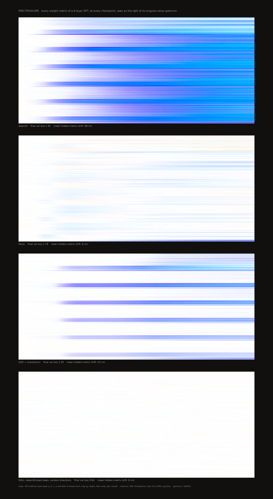
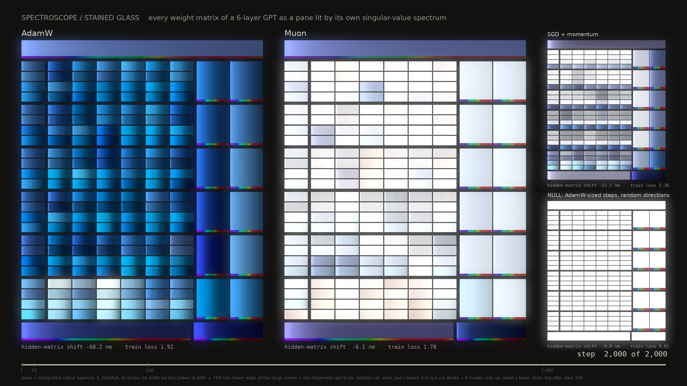

# Spectroscope: the optimiser is a colour

*Every weight matrix of a small GPT, at every checkpoint, rendered as the colour of its singular-value spectrum treated as light. A matrix that looks like its own shuffled copy is white. AdamW turns the network blue. Muon keeps it close to white, with red threads. SGD lands in between. Moving the weights by AdamW's step sizes in random directions stays white.*

## Films (new)

Four films, H.264 2560×1440, 30 fps, ~21 s each: one frame per recorded checkpoint, with a 1 s hold at the start and 3.5–4 s at the end. Time runs every step to ~step 150 and log-spaced after that.

| file | what |
|---|---|
| `gallery/film_glass_main_g1_profile.mp4` (**best**, faithful) | **Stained glass.** AdamW and Muon as two large windows, with SGD and the NULL as small windows. 2,000 steps. |
| `gallery/film_glass_main_g2_profile.mp4` | The same at γ = 2 (declared exaggeration, labelled in frame). AdamW goes deep ultramarine and Muon's warm/cool threads become legible. |
| `gallery/film_glass_wd_g1_profile.mp4` (+ `_g2_`) | Stained glass for the new 10,000-step runs **with weight decay**: AdamW + wd against Muon + wd. |
| `gallery/film_spectrograph_main.mp4` | **Spectrograph.** Six matrices read out like a spectrometer: AdamW / Muon / NULL on the same matrix (L1 mlp up), SGD L1.o, AdamW head (a single-mode spike), and Muon's reddest head. |
| `gallery/film_spectrograph_wd.mp4` | The spectrograph for the weight-decay runs: L1.up, L0.o and head, AdamW + wd against Muon + wd. |

Last frames are in `gallery/still_*_final.png`.

**Stained glass: layout (declared).** Each window reads bottom-up, like the network:
- bottom row: emb, pos;
- then layers 0–5 upward. Each layer is a block of four rows, q, k, v, o. In each row the whole matrix comes first, then a wider lead, then its six head slices. The MLP sits to the right as two tall panes, up and down;
- top row: the output head.

That is all 183 matrices per run. The leading is the dark ground.

**Stained glass: what a pane shows.** Each pane has two scales:
- *macro*: its hue is the integrated colour. This is the same faithful colour as the stills, at γ = 1 unless the file says otherwise.
- *micro*: its brightness across its width is the measured spectral power at 400 → 700 nm, divided by the pane's own 98th-percentile power and clipped at 1. That scale is linear.

So a white-light (flat) spectrum gives an evenly lit pane. A blue-shifted pane is bright at its left edge and fades to the right. The large panes (MLP, head, emb, pos) also carry an 8-px strip of the dispersed spectrum along their lower edge. That strip uses rainbow hue as a wavelength label and brightness 1 − exp(−P/2.5).

A declared glow (a blurred copy added at 0.15) stands in for light scattering in a dark room.

**Spectrograph: what each column shows.** From top to bottom:
1. the integrated colour now, with its shift in nm;
2. the power trace P(λ) on a log axis, with a dashed line at P = 1 (the shuffled null, i.e. white light);
3. the dispersed band now: each wavelength in its hue, linear brightness P/5 clipped at 1, so white light sits at 0.2. Only 0.7% of AdamW's (matrix, checkpoint, wavelength) cells clip, and 0.01% of Muon's;
4. a waterfall of every checkpoint so far, time running downward, with a narrow strip of the integrated colour at each checkpoint on its left.

What the films show that the strips did not:
- **The order of events.** In AdamW the **o rows and down projections go violet first** (step ~30–60), while q, k and v are still white. The whole window then turns blue by step ~200 and relaxes toward cyan.
- **Muon stays a lit white window.** Its pane texture shows the small real deviations, and its only saturated panes are the AdamW-trained emb, pos and head.
- **The NULL is a flat white sheet from first frame to last.** Its panes carry the same step sizes as AdamW's but no light structure.
- **The spectrograph waterfalls show *how* the colour arises.** AdamW L1.up's violet end brightens while the red end goes dark. SGD L1.o goes violet-blue between steps 50 and 150 (dominant wavelength 433 nm at step 150) and drifts toward blue-purple by step 2,000. AdamW's head is a single bright line at 400 nm, with everything else below the null.

### Critique and iteration (films)

1. **First pass: flat panes plus a rainbow band on every pane.** Rejected. The rainbow bands read as colour on *every* pane, including the NULL's. A flat spectrum drawn dispersed *is* a rainbow, so the white windows looked striped and multicoloured. That buried the subject (hue against white) under the wavelength labels. At a distance it looked like a UI table.
2. **Second pass: panes lit by their own spectrum in their own hue** (brightness ∝ power across the pane), with the rainbow kept only as a thin edge on large panes and the leading widened 1.5×.
   - The frame now commits to a key: final frame mean luminance 0.42, with 36% of pixels below 0.15 and 25% above 0.85.
   - AdamW reads as deep, graded blue glass. Muon and the NULL read as luminous white, and the NULL is the flattest.
   - The subject is the most visible thing in the frame: the blue/white split between the two large windows.
   - At γ = 2 AdamW becomes a Chartres-blue window. That version is more beautiful and is labelled as exaggerated.
3. **Spectrograph.** Tried with brightness 1 − exp(−P/2) first. That flattened AdamW's dark red half into the rainbow, so it was switched to linear P/5. The remaining weakness is honest: white light dispersed is a rainbow, so NULL and Muon columns are rainbows. The eye has to compare *brightness* across columns, not hue. The integrated-colour strips beside each waterfall carry the colour.

## New runs: 10,000 steps with weight decay

AdamW (lr 3e-3, wd 0.1) and Muon (lr 0.02, wd 0.015) were run for 10,000 steps each, with everything else as above and 511 checkpoints each. For Muon, the embedding, head and pos were trained by AdamW at lr 1e-3 with wd 0.3. The Muon wd is chosen so that its per-step shrink lr·wd = 3e-4 matches AdamW's at peak lr. Training state is checkpointed every 2,500 steps and resumes after preemption; this was smoke-tested in job 1027, where resumed and straight runs reached val 2.562 vs 2.564.

| run | final val | hidden shift at step 500 / 2,000 / 5,000 / 10,000 | min (step) | final chroma | rows red (> +2 nm) / blue (< −2 nm), of 183 | head spread (noise) |
|---|---:|---|---:|---:|---:|---:|
| AdamW + wd, 10k | 1.583 | −76.4 / −68.7 / −56.2 / **−49.5** nm | −77.4 (687) | 0.104 | 0 / 183 | 11.4 (0.7) nm |
| Muon + wd, 10k | 1.538 | −5.2 / −7.8 / −8.3 / **−7.5** nm | −8.4 (3,902) | 0.016 | **62** / 74, max **+15.9 nm** (L0.o) | 4.9 (0.7) nm |
| *AdamW, no wd, 2k (above)* | 1.911 | −73.0 / −68.2 / – / – | −73.7 (663) | 0.166 | 0 / 180 | 6.9 nm |
| *Muon, no wd, 2k (above)* | 1.776 | −5.2 / −6.1 / – / – | −6.4 (1,233) | 0.012 | 33 / 88, max +8.9 | 3.6 nm |

- **The hypothesis "weight decay pushes toward deep violet" is not supported here.** Over 10,000 steps with wd, AdamW's hidden matrices *relax back toward white*: from −77 nm at step 687 to −50 nm at step 10,000, i.e. from blue toward cyan-blue. Their heads diverge further, with a spread of 11.4 nm against 6.9 nm at 2k.
  - The embedding and positions do go further blue: emb −86 nm against −84 nm at 2k, pos −111 against −99.
- **Muon + wd stays near white but grows its red.** 62 matrices are now flatter than their shuffle (33 at 2k), and the reddest reaches +15.9 nm (+8.9 at 2k). In the stained-glass film these are peach and salmon panes among Muon's white. Most are in layer 0 (19), then layers 4 (14) and 3 (13).
- **Declared confound.** There is **no 10k run without wd**. So "relaxation with length" and "effect of weight decay" cannot be separated. The 2k no-wd runs used a cosine that had already decayed to 0.1× by step 2,000, while the 10k schedule is still near peak there. The trajectories agree to within 4 nm up to step 1,000, so wd has no visible early effect. The next job is the matched 10k no-wd pair (about 50 min each, shared).

## The phenomenon

Each weight matrix W has an eigenvalue spectrum of WᵀW/N. Compare it with the spectrum of the same entries shuffled, which is the Marchenko–Pastur (MP) null: same entries, same Frobenius energy, no structure. Training can only **move energy between modes**, because shuffling preserves the total. The picture asks where each optimiser moves that energy, for every matrix and at every moment.

Result (6-layer GPT, TinyStories, 2,000 steps, one seed per optimiser):

| run | final val loss | mean shift, 36 hidden matrices | mean chroma (xy distance from white) | dominant λ of mean colour | rows red-shifted (> +2 nm) / blue-shifted (< −2 nm), of 180 |
|---|---:|---:|---:|---:|---:|
| **AdamW** (lr 3e-3) | 1.911 | **−68.2 nm** | 0.166 | 476 nm (blue) | 0 / 180 |
| **SGD + Nesterov 0.9** (lr 0.3) | 2.295 | **−22.7 nm** | 0.049 | c575 nm (violet-purple) | 0 / 150 |
| **Muon** (lr 0.02) | 1.776 | **−6.1 nm** | 0.012 | c582 nm (pale lavender) | **33** / 85 |
| **NULL** (AdamW-norm updates, random direction) | 9.843 | **−0.0 nm** | 0.0008 | none (white) | 0 / 0 |
| noise floor (shuffle A vs shuffle B) | | ±0.6 nm s.d. | ≈0.001 | | |

"Shift" is the power-weighted mean wavelength minus 550 nm. A flat spectrum gives exactly 0. Negative means energy moved into the top modes (blue), and positive means energy moved into the bottom modes (red, i.e. flatter than random). "cXXX" is a complementary wavelength, meaning the colour lies toward the purple line.

- **Different optimisers give different colours, and the ordering matches the hypothesis.** AdamW is strongly blue. SGD is intermediate. Muon stays near white, and it is the only optimiser that pushes any matrices red: 33 of 180 rows are flatter than their shuffle, up to +8.9 nm. That fits Muon's orthogonalised updates, whose singular values are all ≈1.
- **The colour is not just how far training got.** At the checkpoint where each run first reaches SGD's final train loss (2.30), AdamW (step 924) is already at −72.6 nm and Muon (step 621) at −5.7 nm.
- **The Muon run carries an internal control.** Muon trains only the hidden matrices. The embedding, position table and head are trained by AdamW in that same run, and they go blue: emb −56 nm and head −105 nm, against −84 / −105 nm under AdamW. In the Muon panel the bottom rows are the only saturated ones.
- **Trajectories differ too.** AdamW blue-shifts fast: −12 nm by step 50, −60 by step 200, and a minimum of −73.7 nm at step 663, after which it relaxes slightly toward cyan. Muon shows a faint early blue transient in its attention rows (steps ~50–300) that fades back to white. SGD's shift is concentrated in the **o and down projections** (−49 and −44 nm, against −8 to −13 nm for q, k, v and up).
  - **Confound, declared:** o and down are initialised 1/√12 smaller, as in GPT-2 practice. At a fixed step size they therefore move further relative to their initial scale. The SGD bars may partly be an init-scale effect and not an SGD effect.
- **The per-head split shows heads diverging in colour.** The within-(layer, type) standard deviation of the 6 heads' shift is 6.9 nm for AdamW (q 8.0, k 9.4, v 4.6, o 5.5), 3.6 nm for Muon and 3.4 nm for SGD. For the NULL it is 0.7 nm, which equals the shuffle-noise floor of 0.6–0.8 nm. So heads diverge at 5–10× the noise. Under AdamW, q and k heads diverge most. Under Muon, v and o heads diverge most.

## The null control

`null`: at every step AdamW computes its update from the model's own gradients. The update is then replaced by a Gaussian random matrix with the **same Frobenius norm**, for every parameter. The weights travel exactly as far as AdamW would send them, but in no particular direction. The model does not learn (val loss 9.84, worse than init). Every matrix stays white: mean shift −0.0 nm and chroma 0.0008, which is at the noise floor.

Two conclusions follow. The colour is caused by the *direction* of the updates, not their size. And the pipeline has no bias toward any hue. Rendered with the same treatment, the NULL is the fourth panel of the hero: a sheet of white light.

The noise check uses the two shuffles recorded at each checkpoint, rendered against each other. They give chroma ≈0.001 and a head-centroid spread of 0.6–0.8 nm.

The MP check replaces the shuffle null with exact MP quantiles at the measured variance. The final hidden-matrix shifts then agree to 0.1 nm: AdamW −68.3, Muon −6.2, SGD −22.8, NULL −0.1.

## What was measured

- **Model.** GPT: 6 layers, d_model 384, 6 heads, context 256, pre-LayerNorm, GELU MLP (4×), no biases, untied embedding and head, learned positions.
- **Data.** TinyStories, train shard 0 (119M tokens). GPT-2 BPE cut to the 8,191 most frequent tokens plus UNK (UNK rate 0.2%). Val loss uses 20 × 64 × 256 tokens from the official validation split.
- **Training.** 2,000 steps × 64 × 256 tokens, bf16 autocast, grad-clip 1.0, 100-step warmup, then cosine to 0.1×. No weight decay in any run.
- **Learning rates.** From 600-step probes: AdamW {1e-3: 2.52, **3e-3: 2.35**}, Muon {**0.02: 2.20**, 0.05: 2.27}, SGD {0.1: 3.34, **0.3: 3.12**, 1.0: 3.86}.
- **Muon.** Newton–Schulz quintic, 5 steps (coefficients 3.4445, −4.7750, 2.0315), Nesterov momentum 0.95, update scaled by √max(1, rows/cols). It is applied to q, k, v, o, up and down. Embedding, positions, head and LayerNorm gains use AdamW at 1e-3.
- **Spectra.** Recorded at **509 checkpoints**: every step to about step 150, then log-spaced to step 2,000. Each covers **183 matrices**:
  - per layer: whole q, k, v, o (384×384) and each of their 6 heads (64×384 row slices for q, k, v; 384×64 column slices for o), plus up (1536×384) and down (384×1536);
  - then emb (8192×384), pos (256×384) and head (8192×384).
- **Eigenvalues.** For each matrix: eigenvalues of the smaller Gram divided by max(rows, cols), for W and for **two fresh entry-shuffles per checkpoint**. They are computed on CPU workers (`eigworker.py`), because GPU `eigvalsh` was slow while the GPU was shared.

## Declared choices

- **Null.** The mean of the two fresh shuffles' sorted eigenvalues at each checkpoint. MP quantiles serve only as a check (they agree, see above).
- **Colour rule.** Settled in `probe_cached.py`; the module version is `spectral.py`, verified to reproduce the probe's output exactly.
  - Wavelength position is the null's cumulative energy fraction by rank. The top modes sit at 400 nm.
  - Power is dF_trained/dF_null.
  - The spectrum is integrated against the CIE 1931 2° CMFs (Wyman–Sloan–Shirley fit). Equal-energy white maps to white.
  - Out-of-gamut colours are desaturated toward white.
  - Every cell is shown at maximum displayable brightness, so colour carries the spectrum's *shape*, not its energy.
- **Known insensitivity.** A single spike in the very top modes lands near 400 nm, where the CMFs are weak. A rank-1 spike ×20 is only faintly violet at γ = 1 (see the key). Low-rank structure is therefore under-coloured, not over-coloured.
- **Gamma.** γ = 1 is faithful. γ = 2 raises P to the power 2 and renormalises. That keeps each hue's direction but roughly doubles its saturation, and it exists to make Muon's red and blue threads legible. Every γ = 2 file is labelled. AdamW at γ = 1 is already saturated, so **the faithful version is the primary one**. γ = 4 was tried and discarded because it turns AdamW into a single violet slab.
- **Layout.**
  - One native cell is one (matrix, checkpoint), enlarged by nearest-neighbour only (4 px wide × 5 px tall).
  - Row order, top to bottom: layers 0–5, each as [q, q.h0–h5, k, k.h0–h5, v, v.h0–h5, o, o.h0–h5, up, down], then emb, pos and head.
  - Columns are checkpoints in order.
- **Ground.** The hero uses a near-black ground (17, 16, 15): light seen in a dark room. The study sheets, key and inset use a cream ground.

## Images

- `gallery/hero_dark_g1.png` (**best**, faithful) and `hero_dark_g2.png`: the four runs stacked, each a Richter-*Strip* style panel of 183 rows × 509 columns.
  - Tonal check: 26% of pixels are below luminance 0.15, 56% above 0.85 and 13% in the mid-range. It is bimodal, lit panels on black, even though the mean (0.68) gives a "commitment" of only 0.18.
- `gallery/study_{adamw,muon,sgd,null}_g{1,2}.png`: labelled per-run panels.
- `gallery/strip_*`: the same panels, bare.
- `gallery/wall_g{1,2}.png`: the first iteration, all runs on the cream ground (critique below).
- `gallery/interleaved_adamw_muon_sgd_null_g{1,2}.png`: every matrix gets four adjacent 2-px rows (AdamW, Muon, SGD, NULL), so the comparison is made row by row. At print size it reads as ruled pinstripe, with one line in four blue.
- `gallery/key.png`: synthetic spectra against the 384×384 MP null. Rank-1 spike, top-10 boost and steeper power (null^1.5) give violet/blue. null^0.9, null^0.6, all-modes-equal (an orthogonal W) and lifted bottom half give salmon/orange/pink. Top modes removed gives near-white.
- `gallery/inset_spectra.png`: the measured spectra (eigenvalue vs rank, log-log) at the final checkpoint for L1.q, L3.up, L4.o.h2, emb and head in each run. Each panel's ground is the colour that spectrum makes.
- `gallery/contact_sheet.png`.
- `gallery/probe_*` come from the earlier CPU probe on cached MLPs.

### Critique and iteration

**Iteration 1: `wall_g1.png`, cream ground.** Key commitment was high (mean L 0.90), and AdamW's blue slab dominated as it should. But the thing the work is about includes the *white* of Muon and the NULL, and white panels on cream paper lose their edges. The NULL was nearly invisible, which buries the null result.

**Iteration 2: the hero, near-black ground.** White now reads as light, and the NULL becomes a luminous white panel rather than an absence. The subject (hue against white) is the most visible thing in the frame: AdamW's blue is the largest saturated mass, Muon a pale woven sheet, and SGD five blue bars.

The γ = 4 attempt was rejected: it saturated AdamW to one flat violet. At thumbnail size Muon and NULL are hard to tell apart at γ = 1. That is the honest reading (Muon's hidden matrices really are within 6 nm of white), and γ = 2 separates them.

## Prior art

- **Martin & Mahoney, *Traditional and Heavy-Tailed Self-Regularization* (ICML 2019) and WeightWatcher.**
  - They read training through the empirical spectral density of weight matrices against MP, with phases running from random-like through bleeding-out, bulk+spikes and heavy-tailed to rank-collapse.
  - Our blue shift is their "bleeding-out / bulk+spikes" seen as colour. They plot ESD histograms and fit power-law exponents. We found no use of ESDs as colour.
- **Muon vs AdamW spectra.** Recent work reports that Muon-trained weights keep higher stable rank and a more uniform spectrum than AdamW. Examples: "The Spectral Dynamics and Noise Geometry of Muon" (arXiv 2606.08388), and Jordan's Muon post on orthogonalised updates.
  - So the *direction* of our result is expected. The contribution here is the rendering (every matrix, head and checkpoint in one field) and the random-direction null.
- **Spectrum-to-colour.** Hyperspectral-to-RGB conversion and Michel-Lévy interference charts are the physical precedents (see `_shared/research-dense-colour.md` §4). U-CIE colours high-dimensional data through CIELAB. We found no precedent for rendering singular-value spectra as light.

## Compute

Summed pasar job time is about 134 min, all run `--mem`-shared beside another agent's jobs, which slowed every step.

| job(s) | what | time |
|---|---|---|
| 978 | smoke | ~3 min |
| 983 | eigvalsh timing | 1 min |
| 984–990 | 7 LR probes, 600 steps each, run concurrently | ~53 min |
| 996, 1005 | AdamW runs, cancelled while GPU eigvalsh was being replaced by CPU workers | ~14 min |
| 1004 | smoke | 5 min |
| **1006** | **adamw** | 16 min |
| **1007** | **muon** | 20 min |
| **1008** | **sgd** | 10.5 min |
| **1009** | **null** | 11 min |
| 1027 | smoke of checkpoint/resume (films session) | 2.5 min |
| **1029** | **adamw10k_wd** (10k steps, 12.6 GiB peak incl. CPU eig workers) | 49.6 min |
| **1030** | **muon10k_wd** | 53.7 min |

The films session used 106 min of GPU job time. That is over the ~1.5 h asked for, because the two 10k runs shared the GPU with each other and with dense-landscape (0.16–0.25 s/step, against 0.09 s/step alone). The films themselves are CPU-only: each takes about 4–5 min to render.

Arrays are in `cache/runs/*.npz` (≈150 MB each, gitignored) and numbers in `metrics.json`.

## Code

- `prep_data.py`: tokenisation. Run it with `uv run --with pyarrow --with tiktoken`.
- `train_gpt.py`: training and spectrum recording.
- `eigworker.py`: CPU shuffles, Grams and eigenvalues.
- `spectral.py`: the colour pipeline, MP quantiles, centroid and dominant wavelength.
- `render.py`: strips, studies, wall, interleaved and metrics.
- `hero.py`, `key.py` (key and inset), `contact.py`.
- `filmlib.py`: shared film code (colour conversion, exposure, bloom, ffmpeg H.264 encoder).
- `film_glass.py`: the stained-glass film. Run it as `--set main|wd`, `--gamma 1|2`, `--still IDX` (stills only).
- `film_spectrograph.py`: the spectrograph film. Run it as `--set main|wd`.
- `train_gpt.py` now checkpoints its training state every `--ckpt-every` steps (default 2,500) and resumes under pasar.

## Not done, and next moves

- **Weight decay was not run** because the budget was spent. The cheapest informative next jobs:
  - AdamW with wd 0.1;
  - Muon with matched per-step shrink;
  - a shuffled-token AdamW run (does data structure, not just the optimiser, set the hue?).
- **One seed each**, so seed spread is unmeasured. The null and the loss-matched comparison make an artefact unlikely, but 2–3 seeds per optimiser would put error bars on the −68 / −23 / −6 nm ordering.
- **The init-scale confound** (o and down initialised smaller) should be removed with a uniform-init SGD run.
- **Next move: the 10k no-wd AdamW/Muon pair.** This separates weight decay from length; the wd pair is now done, see "New runs".
- Earlier plan: a longer AdamW vs Muon pair (20k steps, with wd).
  - It would show whether AdamW's late relaxation toward cyan continues and whether Muon's red rows grow.
  - Its hero would be a single long diptych, AdamW blue against Muon white, at print width (≈8,600 px/m; 20k steps log-spaced to ~2,000 columns).
