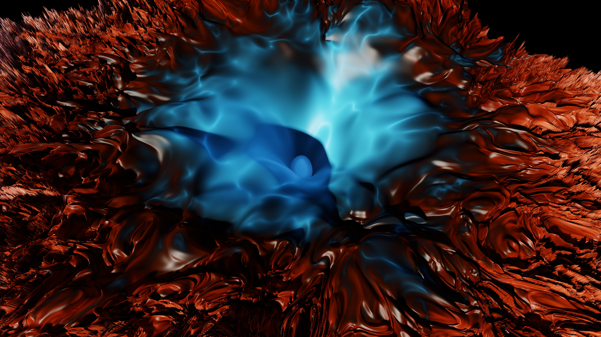
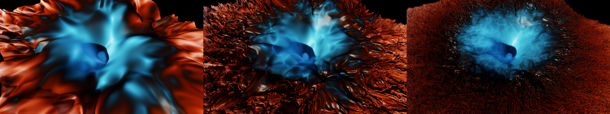
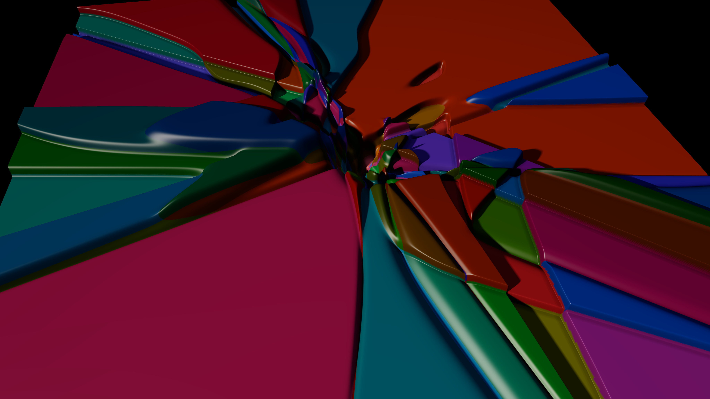
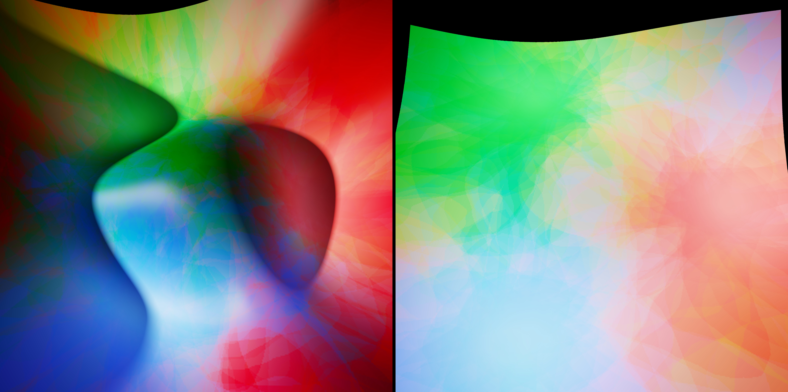
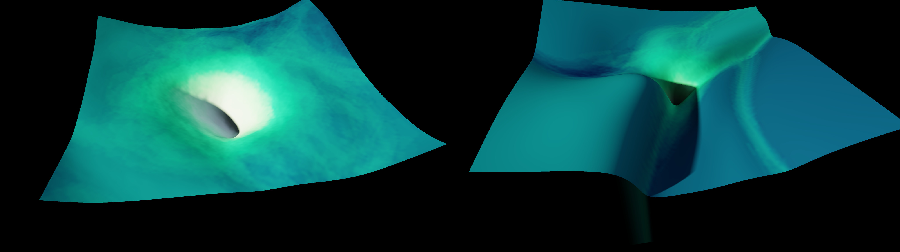
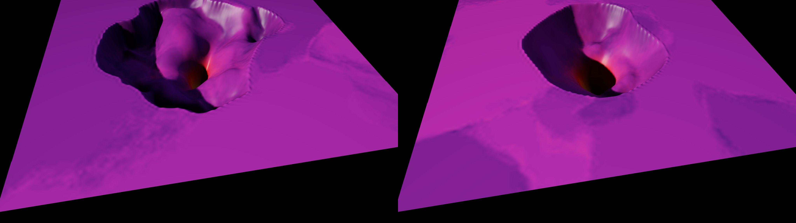
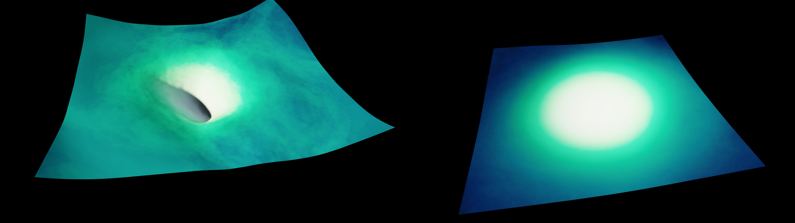
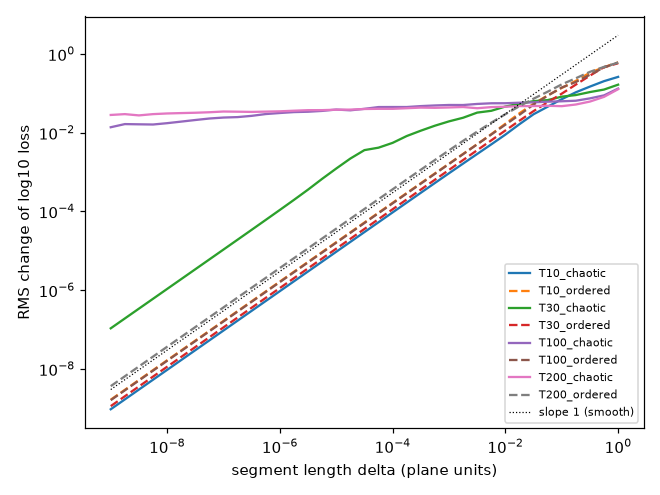

# Wild Landscapes: loss surfaces that are rough for a reason

*Six ways to get a stranger loss surface than the usual smooth bowl, each measured on a fixed
batch and drawn as a lit solid. One of them is rough all the way down, with no sampling noise
involved: the loss of a recurrent net unrolled through its own chaos.*



**Hero: the loss of a trained 32-unit RNN, unrolled for T = 30 steps, over a filter-normalised
weight plane (2049², float64).** The blue crater is the trained net and the region around it where
the recurrent dynamics are *ordered* (largest Lyapunov exponent λ < 0). The rust highlands are the
region where the dynamics are *chaotic* (λ > 0); 72% of the plane is chaotic. The dark seam between
them is the measured edge of chaos. Height is log₁₀ loss, colour is λ. Nothing here is sampled:
the input sequence, the targets and the weights are fixed, so recomputing any point gives the same
number to 16 digits. Measured roughness: in the highlands the loss has a **Hurst exponent
H = 0.31** at scales from 10⁻³ to 10⁻¹ plane units, so the graph dimension there is
**≈ 2.7**. In the crater H = 1.00, which is smooth.

This is the opposite of the finding in `art/dense-landscape/`. There, the famous "fur" on
Ideami-style loss renders was 99.87% minibatch sampling noise. Here the fur is real: it is
deterministic chaos in the forward pass.

## Films (1920 × 1080, H.264, 24 fps)

<video src="gallery/film_zoom.mp4" autoplay loop muted playsinline width="100%"></video>

**`film_zoom.mp4` (12.7 s): zoom ×100,000 into the chaotic highlands.** Every frame is a *fresh*
513² float64 measurement of its window; there is no interpolation between frames. The zoom ends on
a strongly chaotic point (λ = +0.25). The terrain stays crumpled to about ×10². From ×10² to ×10⁴ it
turns into parallel folded strata: the unstable direction of the dynamics is one-dimensional, so
the loss varies along one direction only, like a horseshoe map's layers. Past ×10⁴ the surface
goes smooth, because at T = 30 the chaos has amplified perturbations by only about e^{λT} ≈ 10³–10⁴.
The corner label gives the measured magnification and window. Declared: the relief is rescaled
with zoom (see *Declared choices*), and the timing runs 1:1 to ×10³, then every third window.

<video src="gallery/film_horizon.mp4" autoplay loop muted playsinline width="100%"></video>

**`film_horizon.mp4` (9.6 s): the same plane as the horizon T grows from 4 to 100.** The camera,
light and mapping stay fixed. Frame k shows the running loss mean over the first T steps, one
float64 pass, with each T held for two video frames. The crater settles and the highlands
crumple, then grain down to fur. The fur's grain gets finer with T because λ·T grows (see the
structure function below). The film starts at T = 4, the first step with a non-zero target.

## Gallery



*T = 10 / 30 / 100 (6144 × 1152), same camera, light and mapping. At T = 10 the chaos has not
had time to act and the highlands are smooth folds. At T = 30 they are crumpled at every visible
scale. At T = 100 they are a white-noise fur at the grid scale, and the edge of chaos has become
more ragged. Box-counting dimension of the λ = 0 contour over 2–128 px: **1.06 → 1.21 → 1.50**.*



**Tiny nets, whole weight space: parity-4 with 4 tanh hidden units (25 parameters), a random
filter-normalised plane through a solution, ±5 units, 4096² points, exact full-batch loss over all
16 inputs.** The plane crosses **317 different Boolean functions**. Colour = which function the net
computes (the sign pattern of its output on the 16 inputs). Brightness = how many inputs that
function gets right. Hue is an arbitrary fixed label per function (declared). Height is the loss
itself on a linear scale. Where the hidden units saturate, the loss sits on flat terraces at
multiples of 0.25 (one wrong input = 4/16), and **86% of the plane is on a terrace**. The terraces
are wedges radiating from the origin, because a saturated tanh net depends only on the *direction*
of its weights. All the texture is in the knot near the solution, where every function meets. The
solved region is 0.02% of this plane. [Close-up of the knot, ±0.8](gallery/tiny_parity4_knot.jpg)
(185 functions).



**Three minima (Garipov et al. 2018 Fig. 1, redone): the plane through three independently trained
MLPs** (784-256-256-10, Fashion-MNIST, 90.0/90.1/90.2% test accuracy). Left: raw. Right: the same
three nets after permutation alignment (weight matching, Ainsworth et al. 2023). The function each
net computes is unchanged by alignment (max logit change 6·10⁻⁶). Colour = function identity: agreement
of each point's predictions with net 1 (red), net 2 (green) and net 3 (blue), counted on the 4.2% of
test images where the three nets disagree. Lightness follows the loss, and both plates share one
height and colour mapping.

| | raw | aligned |
|---|---:|---:|
| loss at the three nets | 0.131–0.133 | 0.131–0.133 |
| barrier on each edge (max − mean of the ends) | **0.81, 0.90, 0.87** | **0.046, 0.053, 0.077** |
| loss at the centroid | 1.71 | 0.20 |
| distance between nets | 23.7–23.8 | 16.3–18.8 |

After alignment the three basins merge into one shallow valley, and the plate goes pale because
the same mapping now has nothing high to draw. The colour stays sectored: the aligned nets are in
one basin but are still three different functions on the disputed images.



**Random vs Hessian directions, same ResNet-56 (art/loss-landscape checkpoint), same 128 fixed
images, same height clip.** Left: Li et al. random filter-normalised plane, ±1. Right: the plane of
the top two Hessian eigenvectors (Lanczos on exact Hessian-vector products; λ₁ = 196.5, λ₂ = 119.5,
most negative eigenvalue −6.5). The eigenvectors are rescaled to the same global norm as the random
directions and shown at ±0.05, a window **20× narrower**. In that window the loss already climbs
further (log₁₀ range 3.2 vs 2.7 decades). The Hessian slice is not a bowl: it is a folded sheet with
a sharp straight crease and a narrow slot for the minimum. Its RMS second difference, relative to
its range, is **4.1×** the random slice's. The top eigenvector puts 18% of its weight on a single
tensor, the first conv of the first block. For ResNet-56 without skips, λ₁ = 2165 (11× sharper).



**Chaotic mountains? ResNet-56 without and with skips, zoomed out to ±3 filter-normalised units,
the same 128² grid, 128 fixed images, height clipped at L = 32 (declared).** Neither slice is
chaotic. Out here the loss is a steep funnel. Its log-log slope steepens from **L ∝ r¹²⁻¹⁷** at
r = 1.5–3 to **r³⁶ (no-skip) and r³⁹ (skip)** at r = 1.5–10 (64² pilots, loss up to 10³⁷ with no
overflow). With BN frozen, each of the ~55 perturbed conv layers multiplies the logits. What the
missing skips change is the crater: the no-skip crater is a broad ragged shelf around a pit (only
0.74% of the ±3 plane is below chance loss, vs 1.8% with skips). It is not rougher than the skip
crater by the RMS-second-difference measure. This agrees with the earlier `art/loss-landscape`
null: with this 40-epoch checkpoint, Li et al.'s crumpled no-skip terrain does not appear at any
scale we tried. [Close-up of the no-skip crater, 256²](gallery/resnet56_noskip_crater.jpg).



**Convnet vs transformer, same treatment.** Left: ResNet-56, random plane ±1, 128 images. Right:
the small GPT from `art/spectroscope` (6 layers, d = 384, TinyStories, AdamW checkpoint at step 7.5k,
centre loss 1.47). It uses a random plane ±1 with the same filter normalisation (every row of every
matrix is a filter), a fixed batch of 16 × 256 training tokens, and colour = next-token accuracy.
The transformer slice is an almost perfectly round, shallow bowl: principal-curvature ratio at the
centre **1.10** (ResNet 2.09), 0.9 decades of range (ResNet 2.7), relative roughness 0.00046 (ResNet
0.00106). LayerNorm on every block and 17 M parameters make a random slice very isotropic. It is the
dullest picture in the set, and that is the result.



*The measurement behind "rough for real": RMS change of log₁₀ loss over a segment of length δ,
float64, 800 random base points per zone and horizon. A smooth function has slope 1, which holds for
every ordered zone at every T. In the chaotic zone, T = 30 has slope 0.31 at δ = 10⁻³–10⁻¹ and 0.74
at 10⁻⁶–10⁻³, and becomes smooth only below δ ≈ 10⁻⁶. T = 100 and 200 are flat, with H = 0.02–0.12,
across all nine decades we probed: the loss is effectively discontinuous at every resolvable scale.*

Contact sheet: `gallery/contact_sheet.png`.

## What was measured

| piece | model and data | loss | grid | precision |
|---|---|---|---|---|
| unrolled RNN (`rnn_fractal.py`) | h_t = tanh(W h_{t−1} + u x_t), ŷ_t = v·h_t, n = 32; task y_t = x_{t−3} on one fixed N(0,1) sequence (seed 0); trained with Adam, 1500 steps on T = 200 → loss 6.4·10⁻⁷, spectral radius of W 1.32 | mean over t < T of (ŷ_t − y_t)² | 2049² over ±2.5 (T = 10, 30, 100); 513² per zoom frame; 1025² × 100 horizons | float64 (fp32 only in pilots) |
| Lyapunov colour | same forward pass with a tangent vector q, λ = (1/T) Σ log‖diag(1−h²) W q‖ | — | same | float64 |
| tiny nets (`tiny_nets.py`) | f(x) = w₂·tanh(W₁x + b₁) + b₂, parity-4 with 4 hidden units (25 params), trained with Adam | mean over all 16 inputs of (tanh f − y)² | 4096² | float64, CPU |
| three minima (`three_minima.py`) | 3 × MLP 784-256-256-10, Fashion-MNIST, seeds 0–2, SGD+momentum, 20 epochs | CE on 2048 fixed training images | 512² over ±1.8 r | fp32, TF32 off |
| ResNet planes (`resnet_plane.py`) | art/loss-landscape ResNet-56 ± skips, final checkpoints; P perturbed nets as one grouped conv (matches nn.Module to 1.3·10⁻⁵) | CE on 128 fixed training images, BN eval | 128²–256² | fp32, TF32 off |
| Hessian (`hessian.py`) | same 128 images; conv/linear weights only; scipy eigsh on exact HVPs (74 HVPs); Rayleigh quotients agree to 10⁻⁷ | — | — | fp32 |
| GPT plane (`gpt_plane.py`) | spectroscope GPT, `adamw10k_wd.pt` | next-token CE on 16 × 256 fixed training tokens | 128² | fp32 + TF32 matmuls (checked on a line: max 7.6·10⁻⁵ decades vs full fp32) |

Numbers are in `cache/stats.json` (`analysis.py`) and `cache/rnn/rough.json` (`rnn_rough.py`).

## Null controls and honesty checks

- **Is the RNN texture sampling noise, as in dense-landscape? No.** No part of the loss is
  sampled. The texture comes from the forward pass itself, and a region of the same plane serves as
  the control. The ordered zone (λ < 0) of the same plane, same T and same precision is smooth at
  every scale (H = 1.00 from 10⁻⁹ to 10⁻²). So is the whole plane at T = 10, where the dynamics have
  not had time to amplify anything (H = 0.96–1.00 for δ ≤ 10⁻¹).
- **Is it rounding? No, at T = 30.** float32 and float64 surfaces agree to a median of 2·10⁻⁷ decades
  (99th percentile 1.2·10⁻⁴) on a 257² grid. At T = 100 they do not: in the chaotic zone the median
  disagreement is 0.005 decades and the 99th percentile 0.09. That is why every rendered surface is
  float64, and why the T = 100 fur is only trusted where float64 is: the 10⁻⁹ segment test above
  shows the texture persists far below the grid spacing.
- **Is the chaos real?** The Lyapunov estimate is computed alongside, per point. 72% of the T = 30
  plane has λ > 0 (median λ = +0.09, 99th percentile +0.35). The texture sits exactly where
  λ > 0; the colour boundary and the texture boundary coincide in every image.
- **Trained net inside the chaos?** The crater floor (loss down to 4·10⁻⁶ at T = 30) has λ ≈ −0.28:
  the solution is ordered. It is surrounded by chaos a short distance away, because W has spectral
  radius 1.32 and the input drive is what keeps it stable.
- **Three minima**: alignment was checked not to change any net's function (max logit change
  6·10⁻⁶). Barriers were measured along the straight edges of the triangle, on the same grid.
- **Hessian slice**: directions were rescaled to the random directions' norm, so the 20× narrower
  window is the honest comparison, not an artefact of units.
- **ResNet zoom-out**: 0 non-finite points anywhere up to ±10 (losses up to 10³⁷ stay finite in
  float64 cross-entropy from fp32 logits). There are no "overflow terraces" at this depth. We
  looked and found none.
- **Rendering bug found and fixed**: dense-landscape's `hf._uv` clamps to R − 1 − 10⁻⁴, which
  float32 rounds to R − 1 once R > 2049. Every index then runs one texel off the end, and the first
  4096-px render crashed with a device assert. `wl_render.py` monkeypatches a safe version. The
  Triton kernel has the same clamp and can read one texel past the edge at the very border; we did
  not edit it, because it is outside this directory.

## Declared choices (everything else is data)

- **Height.** RNN: log₁₀ loss clipped below at −1.5, so the crater floor below L = 0.03 is flat,
  K = 0.25 world units per decade on a 2-unit plane. Zoom film: K_k = min(0.25 (2.5/s_k)^0.35,
  0.55/range_k), measured from the window's median. Relief grows as the window shrinks, at roughly
  the rate the loss range shrinks in the rough band (window range ∝ s^0.3–0.5), and is capped to
  stay below the camera. Deeper, the true range shrinks faster than s^0.35, so the last seconds
  visibly calm down; this is the smoothing, shown honestly. Tiny nets: linear loss, K = 0.12. Three
  minima: log₁₀ loss, K = 0.4, shared clip [−0.89, 1.16]. ResNet/GPT: log₁₀ loss, K = 0.25–0.3, clips
  given in each caption.
- **Surface.** Bilinear sheet through the samples (up = 1) for the RNN fields, the tiny nets and the
  zoom frames. Bicubic up ×2 for the 4096-px RNN hero and the three-minima plates. Bicubic up ×4 for
  the 128² ResNet/GPT slices, where the spline passes through every sample and nothing between is
  measured.
- **Colour.** RNN: λ → `crameri_berlin` (palettes.py) at 0.5 + λ/0.8, a dark-centred diverging
  map, so λ = 0 is the darkest seam. Tiny nets: OKLab, L = 0.14 + 0.76·(right/16)^2.5, hue = function
  index × golden angle, chroma 0.09. Three minima: OKLab with hue from the agreement-weighted mean
  of three hue vectors (25°, 145°, 265°, weights ∝ agreement⁶), chroma 0.22, lightness from log loss.
  ResNet: agreement with the centre net → `aurora` (Hessian pair) or `tam` (skip pair). GPT: accuracy
  → `aurora`.
- **Light.** dense-landscape renderer v2 unchanged: warm key with soft marched shadows, cool fill,
  horizon AO, Blinn-Phong/Schlick gloss, ACES. Key at azimuth 200°, elevation 30°, except the raking
  RNN plate (160°, 18°) and the tiny/three plates as listed in `stills_batch*.sh`.
- **Films.** Zoom: s from 2.5 to 2.5·10⁻⁵ exponentially over 360 windows. The centre glides from
  the trained net to the target p as (s/s₀)^1.5. Encoded 1:1 to ×10³, then every 3rd window, then a
  1-s hold. Horizon: each T held 2 frames, starting at T = 4. Burned-in labels are measured values.

## Critique and iterations (against CRITIQUE.md)

Key commitment |mean L − 0.5| of the gallery JPEGs: RNN hero 0.34, raking 0.39, triptych 0.32,
parity-4 0.35, studies 0.29–0.32. All dark key, with the subject as the brightest thing. The
exception is the **three-minima pair at 0.02**, a mid-grey key and a real failure by the house
rule. The pale aligned plate is what makes it grey. It is honest under the shared mapping, but it
means the pair works as a study, not a print.

1. **RNN**, 5 camera passes. The first oblique view showed the plane's edge wall as hairline
   streaks. It was replaced by a steep 55° view that fills the frame. A float32 bug was found and
   fixed: the task sequence had been redrawn in float32, which silently gave a different sequence and
   an apparent centre loss of 0.17. The floor clip at −1.5 turned the six-decade needle-well into a
   readable crater.
2. **Zoom film**, 3 passes. The first render grew the relief without a cap, showed the plane's
   corners, and spent 7 s on a pale flat sheet. The fixes were an axis-aligned full-bleed camera,
   a relief cap, and the re-timing.
3. **Tiny nets.** Continuous function-identity colour (PCA of outputs) looked like plastic toys.
   Crisp sign-pattern colour with correctness as lightness, at low chroma, reads as shattered glass
   and puts the brightness on near-solutions.
4. **Three minima**, 4 passes (ink-mixing was muddy brown, then pastel, then washed out). The
   steep square view with low key light makes the raw plate a sculptural massif with three wells.
   The pair's mid key is unresolved (above).
5. **ResNet zoom-outs**: raw log loss is a featureless funnel. Clipping at L = 32 turned it into a
   mesa with the crater cut in, which is where the skip/no-skip difference lives.

Strongest: the RNN hero, the horizon triptych, the zoom film. The parity-4 plate is the most
graphic. The transformer slice is deliberately included as the dull one.

## Prior art (quick web search, 2026-09-27)

- **Li et al. 2018** (filter-normalised planes, chaotic no-skip ResNet-56); **Garipov et al. 2018**
  (the three-network plane, Fig. 1 left); **Ainsworth et al. 2023** (weight matching); **Yao et al.
  2020** and **Böttcher & Wheeler 2022/24** (*Visualizing high-dimensional loss landscapes with
  Hessian directions*: random projections hide saddles, Hessian directions show them); **Metz et al.
  2021** (*Gradients are not all you need*: chaotic unrolled losses and exploding gradient variance);
  **Pascanu et al. 2013** (cliffs in RNN losses from bifurcations); **Sohl-Dickstein 2024** and our
  `art/trainability-fractal` (a fractal trainable/untrainable boundary in *hyperparameter* space,
  coloured flat); Ideami's losslandscape.com (dense 3-D renders, whose fur `dense-landscape` showed to
  be sampling noise); Ly & Gong 2025 (*multifractal* loss landscapes, Nat. Commun., a model of
  landscapes, not a measured unrolled loss); the 1999 and 1998 XOR 2-2-1 error-surface papers.
- **What seems new here:** (1) a measured, rendered *weight-space* loss terrain whose roughness is
  deterministic chaos, with a structure-function Hurst exponent, a float32/float64 check, and an
  in-plane ordered-zone control; Metz et al. show 1-D slices and gradient variance, not a mapped
  terrain. (2) The horizon film: the same plane crumpling as T grows. (3) The zoom to ×10⁵ showing
  where the roughness ends (strata, then smoothness below e^{−λT}). (4) The whole-weight-space
  Boolean-function map of a tiny net as terraced relief. The Garipov and Hessian pieces are
  re-measurements with new colourings (function identity), not new phenomena.

## Compute

pasar, tag `art-wild-landscapes`, all `--mem` shared, bid 1000, no preemption, no cloud.
**Summed job slot time ≈ 139 min (2.3 GPU-h)**, including ≈ 40 min inflated by running up to eight
of our own jobs side by side in the first hour. The largest items were the no-skip 256² plane (26
min, 1073) and the four 64² zoom-out pilots (31 min, 1051–1054).

| ids | what |
|---|---|
| 1050, 1055 | grouped-conv ResNet benchmark (68 points/s at 128 images alone) |
| 1051–1054 | ResNet-56 ± skip zoom-out pilots, ±4 and ±10, 64² |
| 1056 | train three MLPs |
| 1057/1058, 1064/1065 (1062/1063 cancelled: too slow at 1024²) | three-minima planes 256², 512² |
| 1059, 1060 | Lanczos Hessian, ResNet-56 ± skip |
| 1066 (device bug), 1068 | Hessian-direction plane; 1067 random plane |
| 1061, 1071 | GPT TF32 check, GPT plane |
| 1073, 1077 | no-skip ±3 256², skip ±3 128² |
| 1069/1070 (render bug), 1072 | RNN hero still |
| 1074 (cancelled), 1075, 1076 | zoom film, horizon film |
| 1078, 1079 | stills batches |

CPU (not budgeted): RNN training, all RNN planes (2049² float64 in 25–230 s), 360 zoom windows (~3.5 s
each), 100 horizons, the tiny nets, the roughness analysis, previews, encoding.

```bash
PY=../.venv/bin/python   # from wild-landscapes/
$PY rnn_fractal.py train
for T in 10 30 100; do $PY rnn_fractal.py plane --res 2049 --T $T --span 2.5 --dtype float64 --out cache/rnn/plane_T${T}_r2049_s2.5.npz; done
$PY rnn_rough.py
$PY rnn_film.py compute --frames 384 --res 513;  $PY rnn_film.py hcompute --res 1025 --Tmax 100
$PY tiny_nets.py --task parity4 --hidden 4 --plane random --span 5   --res 4096 --out cache/tiny/p4_h4_rand_s5_r4096.npz
$PY tiny_nets.py --task parity4 --hidden 4 --plane random --span 0.8 --res 4096 --out cache/tiny/p4_h4_rand_s0.8_r4096.npz
# GPU (via pasar; commands as in the job table, from art/):
#   three_minima.py train; three_minima.py plane --align {0,1} --res 512 --n 2048 --span 1.8
#   hessian.py --model resnet56[_noshort] --n 128
#   resnet_plane.py --model resnet56 --dirs {random,hessian} --res 128 --span {1,0.05} --n 128 --P 64
#   resnet_plane.py --model resnet56_noshort --res 256 --span 3 ...; --model resnet56 --res 128 --span 3 ...
#   gpt_plane.py --res 128 --span 1
#   rnn_film.py render --frames 384; rnn_film.py hrender --Tmax 100 --hold 2 --orbit 0,0.02,0,1.3,-90,62,50
#   stills.py --scene rnn_T30 --up 2 --width 4096 --ss 2 --device cuda --orbit 0,0,0,1.5,-120,55,55 ...
#   bash stills_batch.sh; bash stills_batch2.sh
$PY analysis.py; $PY film_encode.py zoom; HOLD=2 $PY film_encode.py horizon; $PY gallery.py
```

Files: `wl_render.py` (Scene wrapper over dense-landscape's `solid.py`/`hfk.py`, plus the
clamp fix), `stills.py` (scene functions: `rnn`, `tiny_sign`, `three`, `field`), `rnn_fractal.py`,
`rnn_rough.py`, `rnn_film.py`, `tiny_nets.py`, `three_minima.py`, `resnet_plane.py`, `hessian.py`,
`gpt_plane.py`, `analysis.py`, `film_encode.py`, `gallery.py`. `pilot/` holds preview scripts and
PNGs. Full-resolution PNGs are in `cache/renders/`, arrays in `cache/`. The gallery is 24 MB.

## Caveats

- Every map is a 2-D slice of a high-dimensional function. The RNN plane varies only W; u and v
  stay at their trained values. One net, one input sequence, one direction pair.
- The RNN's "loss at horizon T" is the training objective restricted to the first T steps of its
  own 200-step training sequence. The trained net overfits that sequence (loss 0.17 on a fresh
  sequence), which does not affect the landscape claims.
- Hurst exponents come from 800 segments per zone and are band averages. The T = 100/200 values are
  near zero, which means "effectively discontinuous at 10⁻⁹", not a precise fractal dimension.
- The edge-of-chaos box dimension uses the finite-T Lyapunov estimate, which is itself noisy near
  λ = 0. Treat 1.50 at T = 100 as an upper-ish estimate.
- ResNet slices use 128 fixed images for speed. `art/loss-landscape` showed 1000 vs 5000 images agree
  to 1.5%, but 128 was not separately checked.

## Next moves

1. **Hang the RNN hero with the triptych**: one plane, three horizons, a 6144-px strip that says
   "chaos makes the fur" in one look. At 8,600 px/m the hero prints about 48 cm wide.
2. **Zoom at longer horizon**: at T = 60 the strata should persist to ×10⁷ before smoothing
   (e^{λT} ≈ 10⁶–10⁷). The float64 limit is the real floor. A 30-s film costs ~40 min of CPU and ~15
   min of GPU rendering.
3. **Train into the chaos**: repeat on an RNN trained for a task that *needs* chaotic dynamics
   (predicting a chaotic series), so the minimum itself sits in the rough zone. This is Metz et
   al.'s bad case, drawn.
4. Retrain ResNet-56-noshort for 300 epochs before trying again to reproduce Li et al.'s crumpled
   slice. Two projects have now failed to see it with the 40-epoch checkpoint.
